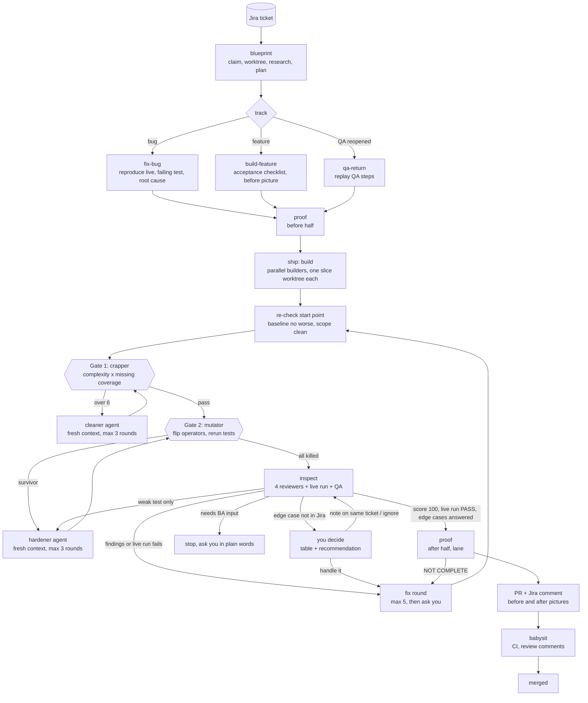
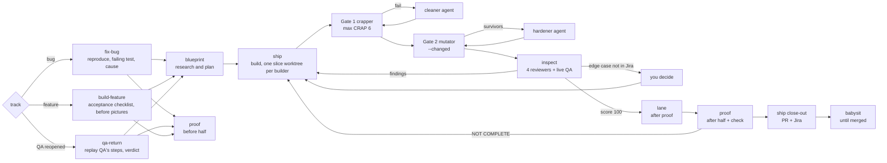
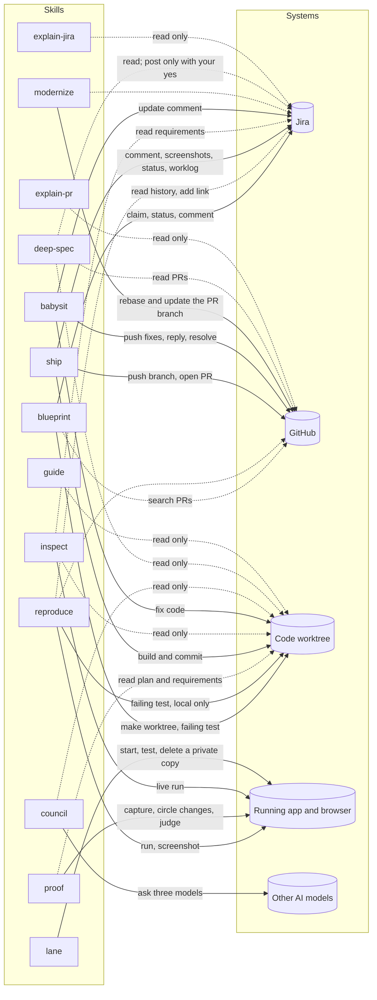

# tstack

The agent skills I use every day to take a Jira ticket from To Do to a merged
pull request, with before and after proof. They work in Claude Code, Codex and
Cursor. Some use [T3 Code](https://github.com/pingdotgg/t3code) features when
they are available and fall back to native tools when they are not.

The idea and the layout of this repo come from
[t3dotgg/tstack](https://github.com/t3dotgg/tstack). The skills are my own.

## Skills

| Skill | Say | What it does |
|---|---|---|
| `full-send` | "full send PROJ-123" | Picks the track and does everything below in one go with nobody watching, and stays on the PR until it is merged. Add `as bug`, `as feature` or `as qa-return` to choose the track. |
| `fix-bug` | "fix-bug PROJ-123" | The bug track. Reproduces the bug live, writes a failing test, finds the root cause, plans, builds and proves the fix. |
| `build-feature` | "build-feature PROJ-123" | The feature track. Turns the BA's acceptance criteria into a checklist, captures the current screen, plans parallel slices, and proves every criterion with its own test and after picture. |
| `qa-return` | "qa-return PROJ-123" | The QA return track. QA reopened a merged ticket: replays QA's exact steps on dev, decides why it failed, fixes it on a new PR from the same branch, and moves the ticket back to Code Review. |
| `blueprint` | "blueprint" | The shared planning steps the three tracks use: picks or takes a ticket, researches with many sub-agents, and writes a checked plan. Typed alone, it picks the track. |
| `reproduce` | (automatic) | Replays a bug step by step, saves the before screenshots and logs, writes a failing test and names the cause. No plan is made until the bug reproduces. If it will not, it says briefly why and how to get unblocked. |
| `proof` | "proof" | Builds one annotated before and after picture per step: before on the left, after on the right, every change circled and numbered, what was asked written on it. Says NOT COMPLETE when the fix does not match the requirements. |
| `ship` | "ship" | Builds the plan with parallel sub-agents, each in its own slice worktree, runs the crapper and mutator quality gates, loops with `inspect` until it passes, opens the PR and updates Jira. |
| `inspect` | "inspect" | Four code reviewers, a live run and a senior QA check of every acceptance criterion. Scores out of 100. Reviewers also list edge cases, and any case Jira does not cover comes to you with a recommendation. |
| `lane` | "lane" | A private running copy of the app per agent, for screenshots, API calls and logs. Aruva-specific. |
| `babysit` | "babysit" | Watches a PR through CI and review, fixes real findings, resolves every comment, stays until merged. |
| `deep-spec` | "deep-spec PROJ-123" | Investigation only, no code. Checks the ticket's claims against the code, finds work already built or about to merge, reviews security and likely bugs, grills you and runs a council, then rewrites the spec. Posts to Jira only with your yes on the exact text. |
| `council` | "council" | Gets a review from Grok, Claude Opus and GPT at medium effort, and loops until they agree. |
| `modernize` | "modernize" | Rebases an old PR and decides if it should still exist. |
| `explain-jira` | "explain-jira" + Jira link | Explains the ticket, what each person is asking, and what to do next. |
| `explain-pr` | "explain-pr" + PR link | Explains the PR, what each reviewer is asking, and what to do next. |
| `guide` | "guide" | Says how each skill works and, mid-chat, where the work stands and what to type next. |
| `plain-talk` | "plain-talk" | Explains any ticket, bug or result in everyday words with real-life examples, no analogy unless asked. |
| `unslop` | (automatic) | The writing style for every reply, plan, commit, PR and Jira comment. |
| `agents-first` | (automatic, Claude only) | Runs at the start of every task. When the work splits, asks before spinning up several agents and picks the approach and the model for each. |
| `agents-subagents` | "use subagents" | Helper Claudes inside one session: built-in types, agent files, models, limits. |
| `agents-view` | "claude agents" | Background sessions you hand off and check on later. |
| `agents-teams` | "spawn a team" | A lead and teammates who share a task list and message each other. |
| `agents-messaging` | "tell the other session" | Passing findings and status between your sessions. |
| `agents-workflows` | "use a workflow" | A script that runs dozens of subagents, with saving, resuming and cost limits. |
| `agents-worktrees` | "use a worktree" | A separate copy of the repo per session or agent so edits don't collide. |
| `agents-models` | "which model" | Which model and effort level fits each task and each agent. |
| `postwork` | (automatic) | Reviewer: checks finished work against its ticket. |
| `ticket-prework-review` | (automatic) | Reviewer: checks a ticket and plan before building starts. |

## The whole flow, for any stack

The flow does not depend on a language. The gates run on Python, TypeScript, JavaScript, Java, Go, Rust and Clojure, and the rest only needs git, a test command and a running copy of the app.



| Stage | Who does it | What stops it |
|---|---|---|
| Plan | `blueprint` | A requirement that is not in Jira. It asks you. |
| Build | `ship` builders, one worktree each | A plan that is wrong. The builder stops and says so. |
| Gate 1 | `crapper`, then a cleaner | 3 rounds without a pass, then a card to you |
| Gate 2 | `mutator`, then a hardener | 3 rounds without a pass, then a card to you |
| Check | `inspect` | Score under 100, live run FAIL, or an unanswered edge case |
| Close | `ship`, `babysit` | A proof that is NOT COMPLETE |

## Quality gates: crapper and mutator

Two tools that give a pass or a fail, so no agent has to judge code quality by feel. They are forks of Uncle Bob Martin's [crapper](https://github.com/unclebob/crapper) and [mutator](https://github.com/unclebob/mutator), described in [this interview](https://www.youtube.com/watch?v=zcLPGC-tvgk). Models drift on long rule documents, but a tool that exits non-zero does not.

| Tool | Question it answers | Pass | Fail |
|---|---|---|---|
| `crapper` | Which changed functions are too complex and too little tested? CRAP = CC² x (1 - coverage)³ + CC | exit 0 | exit 2 when the worst score is above the limit (6) |
| `mutator` | Do the tests notice when a line changes? It flips `==` to `!=`, `+` to `-`, and so on, and reruns the tests | exit 0, every mutant killed | exit 3, a mutant survived. Exit 2 means the baseline tests fail |

The limit is 6, not the human-sized 4, because agents handle more branches per function than people do. Lower it for a repo with a written reason in the plan.

A failing gate starts a short-lived agent with a fresh context and one job. A cleaner lowers the score. A hardener adds a test that kills the survivor. Each gate allows 3 rounds, then asks you. Full rules are in [skills/ship/references/quality-gates.md](skills/ship/references/quality-gates.md).

### Edge cases

Each of the four `inspect` reviewers also lists edge cases that could fail the PR, QA or the Jira acceptance criteria. A case Jira already covers becomes a normal finding. A case Jira does not cover comes to you:

| # | Edge case | How it fails | In Jira? | Recommendation |
|---|---|---|---|---|
| 1 | ARPP-123: a teacher saves a course with no chapters | The page shows a blank error | Not found | Handle it in this PR, a 3-line check |
| 2 | ARPP-123: two admins save at the same moment | The second save overwrites the first | Not found | Note on the same ticket, ship without it |

You answer "Handle it in this PR", "Note on the same ticket" or "Ignore". The answer goes in the decision log in your words, and `inspect` does not pass while a case waits. No new ticket is ever created.

## Examples

Run a whole ticket with nobody watching:

```text
full send ARPP-123
```

Start with a plan only, then build later:

```text
blueprint ARPP-123, plan only
ship ARPP-123
```

Check work somebody else built:

```text
inspect ARPP-123
```

Run the gates by hand on the files you changed. What you see for crapper, on the mutator repo itself without coverage:

```text
$ ~/.agents/tools/crapper/crapper --changed --threshold 6
CRAP Report
===========
Languages: python

Function       Namespace      CC   Cov%   CRAP
------------------------------------------------
parse_args     mutator.cli    30   N/A    N/A
_select        mutator.engine  9   N/A    N/A
```

With coverage on, a function with CC 9 and 50% coverage scores 9 x 9 x 0.125 + 9 = 19.1, over the limit, so Gate 1 starts a cleaner. Without a coverage report the score is `N/A` and the limit cannot fail, so the gate tells you to rerun with coverage.

What you see for mutator, listing the changes it would try without running tests:

```text
$ ~/.agents/tools/mutator/mutator --scan src/mutator/model.py
Scan: 5 mutation sites in src/mutator/model.py
  src/mutator/model.py:52 + -> -  [defn/score]
  src/mutator/model.py:53 == -> !=  [defn/score]
  src/mutator/model.py:55 / -> *  [defn/score]
```

A real run executes the tests once per site. If the tests still pass after `+ -> -`, that mutant survived, and the hardener writes a test that fails on it.

## How they fit together

The pipeline, in order. `full-send` runs the whole chain. Each track has its own start and its own definition of done, then they share the same build, check and close-out.



- `fix-bug`, `build-feature` and `qa-return` use `blueprint` and `agents-first`. `fix-bug` and `qa-return` use `reproduce`.
- `blueprint` uses `ticket-prework-review` and `lane`.
- `reproduce` and `ship` use `proof`. `proof` uses `lane`.
- `inspect` uses `postwork` and `lane`.
- Everything uses `unslop`.

## What each skill can touch

A solid arrow means the skill changes that system. A dotted arrow means it only reads.



| Skill | Jira | GitHub | Code | Running app | Never does |
|---|---|---|---|---|---|
| `blueprint` | Assigns the ticket to you, moves it to In Progress, posts the plan comment | Reads PRs | Makes the worktree, commits one failing test locally | Through `reproduce` and `lane` | Push, or change product code |
| `reproduce` | Reads tickets, links a repeat bug to the old one | Reads PRs and history | Commits a failing test locally | Runs it, takes before screenshots and logs | Push |
| `proof` | Nothing | Nothing | Reads the plan and the diff | Drives a visible Chrome, takes the before and after pictures | Edit code, mark a step as matching without evidence |
| `ship` | Comments, uploads screenshots, moves to Code Review, logs time | Pushes the branch and the proof, opens the PR | Builds and commits inside the worktree | Through `inspect` and `lane` | Merge, force-push, touch production |
| `inspect` | Reads. Drafts bugs, files them only with your yes | Reads the diff | Reads only | Runs every scenario live | Edit code |
| `lane` | Nothing | Nothing | Reads the worktree to build from | Starts and deletes its own private copy | Touch another agent's copy or the shared stack |
| `babysit` | Posts the review-fix and merge updates | Pushes fixes, replies, resolves threads | Fixes what CI and reviewers found | Reruns the live steps a fix touches | Merge, unless you asked in clear words |
| `modernize` | Reads the ticket | Updates the PR's own branch after a rebase | Rebases | Reruns checks | Merge, close, widen the scope |
| `council` | Nothing | Nothing | Reads only | Nothing | Edit anything |
| `deep-spec` | Reads. Edits the description and posts comments only with your yes on the exact text | Reads PRs | Makes the task worktree, reads only | Nothing | Change code, claim or post without your yes |
| `explain-jira` | Reads only | Nothing | Nothing | Nothing | Post without your yes |
| `explain-pr` | Reads the ticket summary | Reads only | Nothing | Nothing | Post, resolve or push without your yes |
| `guide` | Nothing | Nothing | Reads the task files | Nothing | Change anything |

Every skill stops and asks before these: a force-push or history rewrite, a database migration, anything on shared, staging or production systems, secrets, dependency upgrades, CI changes, and deleting tests.

## What the pipeline promises

- Requirements come only from words the BA wrote in Jira. Every decision is logged with its source, and a sub-agent that may answer only from Jira grills the plan. A script fails any decision that is not grounded.
- Nothing passes without a live run. UI changes are proven with UI screenshots.
- A bug is reproduced first, in Docker or a lane, in a visible Chrome window. If it will not reproduce, the agent works on the blocker for up to 3 rounds, then reports it and stops. No plan is made.
- The before and after proof is mandatory. A script checks it at each stage, builds one annotated before and after picture per step (changes circled and numbered, what was asked written on it), and checks the images are on the Jira ticket and in every PR. Only you can skip it, by saying "skip proof".
- You get updates in simple words: a progress table, what was just fixed and why, and what is being fixed now. Every 10 minutes by day, every hour in the evening, none overnight.
- One folder per task, `worktrees/ARPP-1234/fe`, `be` and `ai`, all made by `blueprint`, used by every later skill, and moved to `archived-worktrees/` by `babysit` once the PRs are merged.
- Every skill keeps a temporary to-do list, ticks items with evidence, shows the table, what is left and the blockers in each update, and the list deletes itself when everything is ticked.
- The system is strict. Skills follow their steps in order, and the progress board refuses to skip a stage.
- The chat is named after the ticket: `PROJ-123` for the pipeline, `JC PROJ-123` for Jira comments, `GC PROJ-123 #45` for GitHub comments.

## Install

```bash
npx skills@latest add talibilat/tstack -g
```

Or by hand:

```bash
git clone https://github.com/talibilat/tstack
cp -R tstack/skills/* ~/.claude/skills/   # Claude Code
cp -R tstack/skills/* ~/.codex/skills/    # Codex
```

## Setup

Install the gate tools once. `mutator` expects `crapper` in a folder next to it.

```bash
mkdir -p ~/.agents/tools && cd ~/.agents/tools
git clone https://github.com/talibilat-awtg/crapper
git clone https://github.com/talibilat-awtg/mutator
(cd crapper && uv venv --python 3.12 .venv && uv pip install -e . --python .venv/bin/python)
(cd mutator && uv venv --python 3.12 .venv && uv pip install -e . --python .venv/bin/python)
```

Check them: `~/.agents/tools/crapper/crapper --help` and `~/.agents/tools/mutator/mutator --help` should both print usage.

There is nothing to fill in before the first run. The skills ask for what they need, once:

- **Jira and repos.** On first run, `blueprint` writes `skills/blueprint/references/setup.md` from your Jira and git tools and asks for the rest. Add your BA's name there.
- **Jira API token.** Needed only to upload screenshots to tickets. The skill asks for it once and saves it in `~/.config/tstack/jira.env`, outside the repo.

## Requirements

- An Atlassian Jira connector in your agent.
- An authenticated [GitHub CLI](https://cli.github.com) (`gh`), and git.
- `python3` for the progress board, the PR status script and the Jira upload.
- [uv](https://docs.astral.sh/uv/) and Python 3.12 for the two gate tools.
- A test command for each repo, with coverage turned on. Gate 1 needs a coverage report to score anything.
- `council` needs sub-agents on other providers' models. T3 Code does this with `delegate_task`.
- `lane` needs the local Aruva setup in `skills/lane/references/setup.md`.

`postwork` also reads Matt Pocock's `code-review` skill. That file is not in this repo. Copy it to `skills/postwork/references/matt-code-review.md`.

Optional reviewers, used when installed: `interrogate` and `blast-radius` (pstack), `ponytail-review`, `thermo-nuclear-code-quality-review`, `grilling`, `diagnosing-bugs`, `tdd`. A missing reviewer shows as NOT RUN.

## Run agents first (Claude Code)

The `agents-*` skills come from the Claude Code docs pages on
[subagents](https://code.claude.com/docs/en/sub-agents),
[agent view](https://code.claude.com/docs/en/agent-view),
[agent teams](https://code.claude.com/docs/en/agent-teams),
[cross-session messaging](https://code.claude.com/docs/en/cross-session-messaging),
[workflows](https://code.claude.com/docs/en/workflows),
[worktrees](https://code.claude.com/docs/en/worktrees) and
[model configuration](https://code.claude.com/docs/en/model-config).
`agents-first` reads the others when it picks an approach.

To run `agents-first` on every task, add this line to `~/.claude/CLAUDE.md`:

```text
When Claude is the main model, start every task with the agents-first skill: read and apply `~/.agents/skills/agents-first/SKILL.md`. When the task splits across agents, always ask before spinning them up.
```

## Make them yours

These are starting points. Edit them. Whatever you type after a skill name outranks the skill's own rules, so "blueprint PROJ-123, plan only" or "updates every 30 minutes" just works.

## License

[MIT](LICENSE)
